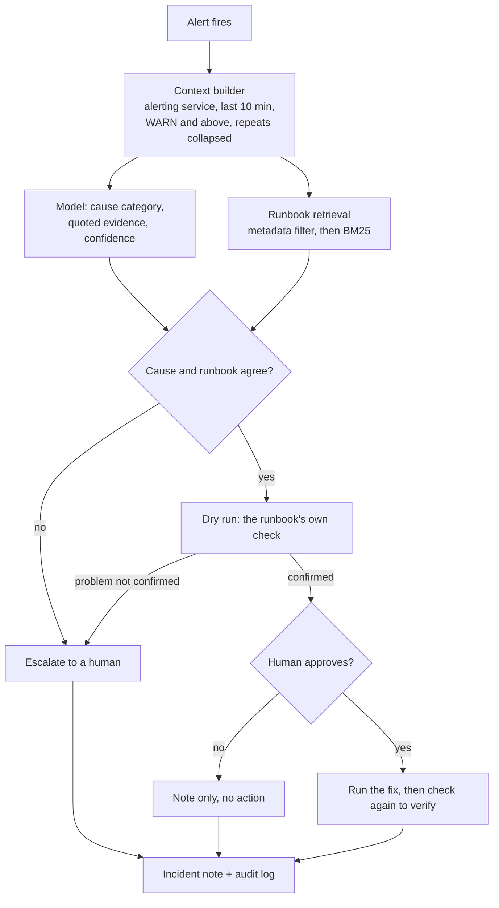

# AI Incident Triage Agent

[](https://m8ven.ai/mcp/dineshravichandiran-ai-incident-triage-agent-j6zcpn?s=readme)

An alert comes in. The agent filters the logs, names the likely cause, picks the right runbook step, drafts the incident note, and **waits for a person to approve before any fix runs**.

It runs on a synthetic lab with known root causes, so every claim below is measured against ground truth rather than judged by eye.



## The design choice that matters

The model decides **one thing**: reading the evidence and naming the likely cause. Everything around it is ordinary code, so the model cannot skip a step or approve its own fix.

- **Filter before the model.** Only the alerting service, the last 10 minutes, WARN and above, with repeated lines collapsed into one pattern and a count.
- **Two routes must agree.** The cause category comes from the model. The runbook comes from retrieval over the model's explanation. A fix is only proposed when they agree; otherwise a person decides.
- **Dry run by default.** The runbook's own check runs first. If it does not confirm the problem, nothing runs, even if the model sounded sure.
- **The approval gate is enforced in code, not in the prompt.** A real run needs a single-use approval id that a human issued, tied to one runbook on one service. The MCP server checks it itself, so a client that skips its own confirmation still cannot run a fix.
- **The note is written by code, not the model**, so it cannot contain invented facts.
- **Every step goes to a JSON audit log.**

## Try it (no key, no model; Python 3.10 or newer)

```bash
python3 -m venv .venv && . .venv/bin/activate
pip install -r requirements-dev.txt
python -m triage demo E01 --yes     # alert -> cause -> dry run -> approved fix -> verify -> note
python -m triage demo E01           # without --yes (or with no terminal) the answer is "no": nothing runs
python -m pytest -q                 # 72 tests
```

The offline backend is a keyword list, **not a language model**. It exists so the project runs anywhere and gives the evaluation something to beat. Real transcripts are in [docs/evidence/](docs/evidence/).

## Results

20 frozen incidents (two per cause), each run twice per context mode. Cause and runbook are scored against ground truth. "Quoted lines not in context" counts evidence lines the model quoted that do not appear verbatim in what it was shown.

**Larger hosted model**

| Context | Cause correct | Right runbook | Quoted lines not in context | Mean input tokens | Minus fixed overhead | Mean latency |
|---|---|---|---|---|---|---|
| raw logs | 40 / 40 | 40 / 40 | 0 of 120 | 29,886 | 28,119 | 6.6s |
| filtered | 40 / 40 | 40 / 40 | 0 of 116 | 2,618 | 851 | 5.2s |

**Smaller hosted model**

| Context | Cause correct | Right runbook | Quoted lines not in context | Mean input tokens | Minus fixed overhead | Mean latency |
|---|---|---|---|---|---|---|
| raw logs | 37 / 40 | 38 / 40 | 0 of 120 | 20,402 | 18,654 | 23.8s |
| filtered | 39 / 40 | 40 / 40 | 4 of 120 | 2,418 | 670 | 12.8s |

**Keyword baseline (no model, 20 runs per mode)**

| Context | Cause correct | Right runbook |
|---|---|---|
| raw logs | 9 / 20 | 10 / 20 |
| filtered | 11 / 20 | 12 / 20 |

What these say, and what they do not:

- **The larger model gets everything right with or without the filter.** There the filter saves cost and time, not accuracy: 91% fewer input tokens as reported (97% once a fixed 1,767-token per-call overhead is removed) and about 21% lower latency.
- **The smaller model is where noise matters.** Raw logs went wrong on incidents that hide a large old incident in the hour of logs; the filtered context drops it. 37 vs 39 correct is **directional, not proven**: 20 incidents, two repeats that are not independent.
- **No wrong fix would have run in any wrong-cause run.** Of the 4 wrong-cause runs by the smaller model, every one was stopped by the cause/runbook disagreement or by the runbook's own check. In the lab the check passes only for the true fault, so this demonstrates the design; it is not a measurement of how real checks would behave.
- **The smaller model quoted 4 lines that are not verbatim in the filtered context** (none in raw). I have not checked whether those were paraphrases or inventions.
- **Incident E03 is arguably ambiguous.** A process panic with a nil-pointer message and a process that exited can read as either "service down" or "bad deploy". The smaller model flipped between the two across three tries and sometimes wrote "a recent deployment" with no deployment in the evidence. I did not change the label after seeing results.

Full per-run rows are in [evals/results/](evals/results/). The tables above were produced through the command backend with two hosted models; that adapter is not in this repo. With your own model (`--backend ollama`) the numbers will differ.

### How the evaluation was built

- **Dev and eval are separate.** 10 dev incidents were used to build and tune the filter and the retrieval. 20 eval incidents were frozen (`lab/manifest.json` holds a hash of each; a test fails if the data changes) before the final run, and nothing was tuned after.
- **The first version was too easy.** A keyword baseline scored 20 of 20 on it, so it could not tell anything from anything. Before any model was run on the eval set, I made it harder in realistic ways: paraphrased wording, quiet failures with only 5 to 10 true lines, generic 500 errors that are a consequence of the real fault, weak look-alike lines, and a large old incident earlier in the hour.
- **Retrieval was checked without a model first.** On the dev set the right runbook came back 9 of 10 times (the checkpoint was 8). The one miss led to one change: the DNS runbook now uses the vocabulary DNS errors actually use.
- **Tokens:** the "input tokens" columns are what the backend reported. A character-based estimate under-counts log text by about 2.4×, so it is only used where nothing is reported.

## Use it with a model

```bash
# a local model through Ollama
python -m evals.run --backend ollama --model <your-model> --set eval --repeats 2

# any program: JSON request on stdin, JSON reply on stdout (see examples/adapter_template.py)
TRIAGE_LLM_CMD="python my_adapter.py" python -m triage demo E04 --backend command --yes
```

## Tracing: where the time and tokens go

`--trace` (or `TRIAGE_TRACE=1`) records one trace per incident and one span per step: `context.build`, `llm.call`, `runbook.retrieve`, `runbook.dry_run`, `approval.wait`, `runbook.fix`, `note.write`. Waiting for the human is its own span, so people-time is not mistaken for agent time. Model calls carry the OpenTelemetry GenAI attribute names (`gen_ai.request.model`, `gen_ai.usage.input_tokens`, `gen_ai.usage.output_tokens`). It is off by default and writes nothing when off.

```bash
python -m triage demo E04 --yes --trace            # spans go to .lab_state/traces.jsonl
python -m evals.run --backend rules --set eval --trace
python -m triage trace-report                      # latency per step (mean, p95, max), tokens, errors
python -m triage trace-report --prices '{"my-model": {"input": 3.0, "output": 15.0}}'   # adds cost
python -m triage trace-report --otlp-endpoint http://localhost:4318    # send the spans to an OTLP/HTTP backend
```

- **Cost needs your prices.** No price table is built in, because it would go stale and put a made-up number in the report. Without prices the report says `n/a`.
- **Tokens appear only for backends that report them** (`ollama`, and `command` adapters that return `usage`). The offline `rules` backend is not a model, so its rows show 0 tokens. See [docs/evidence/tracing-report.txt](docs/evidence/tracing-report.txt) for a real run on it.
- **What is and is not verified.** The span structure, token and cost arithmetic, error handling, per-thread traces and the OTLP/JSON payload are tested (16 tests), including a real HTTP POST to a local stand-in receiver. I have **not** sent spans to a live tracing backend such as Langfuse or Grafana Tempo, so treat the exporter as untested against a real one.

## Retrieval: BM25, embeddings, or both

Runbook steps are ranked by BM25 by default. `--retrieval dense` or `hybrid` (or `TRIAGE_RETRIEVAL`) adds embeddings: `dense` is cosine similarity, `hybrid` fuses the BM25 and dense rankings with reciprocal rank fusion. The embedder is `lsa` by default (TF-IDF plus a truncated SVD in numpy, fitted on the runbooks, fully offline) or a local Ollama model (`ollama:nomic-embed-text`).

```bash
python -m evals.retrieval_eval                                   # offline LSA
python -m evals.retrieval_eval --embedder ollama:nomic-embed-text   # needs `ollama pull nomic-embed-text`
python -m triage demo E04 --yes --retrieval hybrid
```

Measured with the offline LSA embedder, 50 hand-written queries over 10 runbooks (30 step chunks), ranking the right runbook first (R@1), full table in [evals/results/retrieval-lsa.md](evals/results/retrieval-lsa.md):

| Query set | BM25 | Dense (LSA) | Hybrid |
|---|---|---|---|
| Written, metadata filter on (50) | 42 | 46 | 46 |
| Written, filter off (50) | 39 | 40 | 42 |
| Written, everyday words only, filter off (30) | 19 | 20 | 22 |
| Written, shared terms only, filter off (20) | 20 | 20 | 20 |
| Lab incidents, filter on (30) | 25 | 25 | 24 |

- **What it shows.** Embeddings help a little when the query avoids the runbook's own words, and make no difference when they overlap. On the lab incidents, where the log text and runbooks share an author, hybrid is not better (24 against 25). Through the whole pipeline with the offline rules backend, the right runbook came back 13/20 with hybrid against 12/20 with BM25: one incident, so noise.
- **Why the gain is small.** LSA only learns from 30 short chunks and does not know English, so a word that never appears in the runbooks adds nothing. A real embedding model should do better on everyday phrasing, but I have **not** run one: the Ollama embedder is tested only against a local stand-in server, and no number here comes from it.
- **Small, single-author set.** The 50 queries were written by the same person as the runbooks, before the methods were compared, and one query is 2 points. The defaults are unchanged: BM25 stays the default because the evidence does not justify switching.

## MCP server

Four tools over stdio: `get_alerts`, `get_logs`, `run_runbook` (dry-run by default), `write_incident_note`. Set `TRIAGE_ALERT_TYPE` to load only the tools that fit an alert (`run_runbook` is offered only when a runbook exists for it).

```json
{ "mcpServers": { "incident-triage": { "command": "python", "args": ["-m", "triage.mcp_server"], "cwd": "/path/to/this/repo" } } }
```

A real fix needs an approval id issued by a person (the CLI prompt does this); the server refuses a missing, made-up, reused, or mismatched id. Tests drive the real server over stdio.

## Alert source

`python -m triage watch` reads the Prometheus exporter from [grafana-observability-stack](https://github.com/dineshravichandiran/grafana-observability-stack) and applies the same thresholds as that repo's Grafana rules (error rate over 15, latency over 600 ms, memory over 90). That exporter serves no logs, so triage in this repo uses the lab's logs.

## What this does not show

- **It is synthetic, written by one person.** The log wording and the runbook text share an author, so word overlap is higher than on real systems. This measures the pipeline (filtering, retrieval, tool use, approval), not accuracy on real production logs.
- **Fixes are simulated.** A "fix" changes a field in `.lab_state/`; it never touches a real machine. The runbook checks read that simulated state.
- **One service's logs per incident**, and a one-to-one mapping between cause and runbook, which is simpler than real life.
- **Small sample.** 20 incidents; treat gaps of a few runs as noise.

## Layout

```
triage/         lab.py (incident generator)  context.py (filter)  rag.py (chunks, BM25, hybrid)  embed.py (LSA, Ollama)  llm.py (backends)
                agent.py (pipeline)  executor.py (check, approve, fix, verify)  tools.py  mcp_server.py  cli.py
                tracing.py (spans, report, OTLP export)
runbooks/       10 YAML runbooks: diagnose, fix, verify
evals/          run.py, retrieval_eval.py, retrieval_queries.yaml and the saved results
lab/            manifest.json: the frozen data fingerprint
tests/          85 tests, including attempts to get around the approval gate
docs/evidence/  real transcripts
```

## License

MIT. See [LICENSE](LICENSE).
